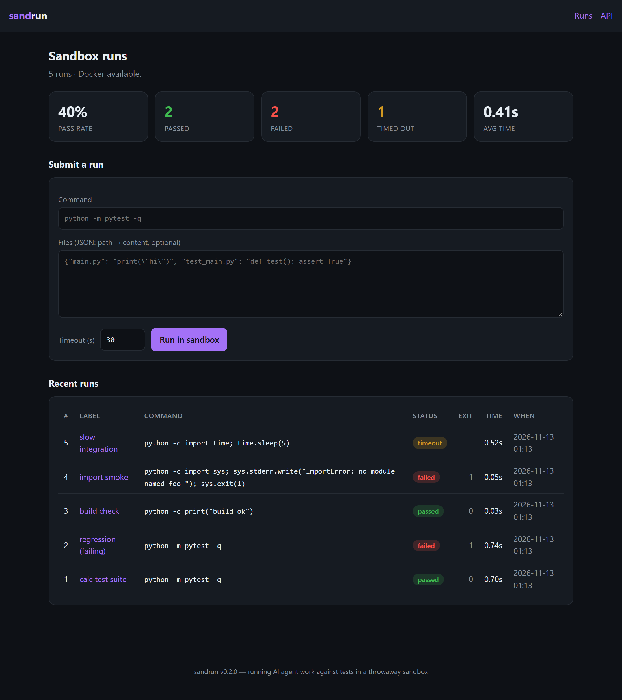
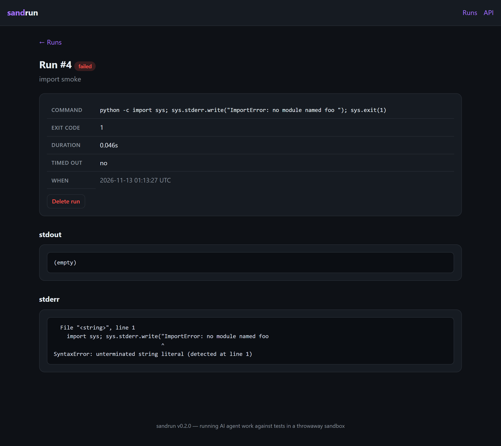

# sandrun

[](https://github.com/BoogeyCodes/sandrun/actions/workflows/ci.yml)


Run an **AI coding agent's work against tests in an isolated sandbox** — and keep a history of every
run with a pass rate. Submit a set of files plus a command; sandrun materialises them into a throwaway
workspace, runs the command under a timeout (locally, or inside a Docker image), and records a
structured pass/fail result you can browse on a dashboard or pull from a REST API.

It comes as three things in one package:

- a **web dashboard** — submit a run from the browser and watch pass/fail/timeout stats build up;
- a **REST API** — submit runs and read results as JSON, to wire into an evaluation harness or CI;
- a **CLI + library** — sandbox a single command, or call the runner from your own code.

The runner engine has **no dependencies**; the web layer is an optional extra.



## Quick start

```bash
pip install -e ".[web]"      # runner + web dashboard & API
sandrun serve                # http://127.0.0.1:8000  (runs persist in sandrun.db)
```

Sandbox a single command from the shell (no extras needed):

```bash
sandrun --dir ./repo -- pytest -q      # run tests in a throwaway copy of ./repo
sandrun --timeout 30 -- npm test       # with a timeout; exit 0 on pass, 1 on fail
```

Or use the library directly:

```python
from sandrun import run_in_sandbox

result = run_in_sandbox(
    files={"calc.py": "def add(a, b):\n    return a - b\n",            # buggy repo
           "test_calc.py": "from calc import add\nassert add(2, 3) == 5\n"},
    overlay={"calc.py": "def add(a, b):\n    return a + b\n"},         # the agent's fix
    command=["python", "test_calc.py"],
)
result.passed        # True — the agent's change makes the test pass
result.summary()     # "PASS (exit 0, 0.1s)"
```

With Docker:

```bash
docker build -t sandrun .
docker run -p 8000:8000 -v "$PWD/data:/data" sandrun
```

## The service

Submit a run (files + command); it executes in a sandbox and the verdict, timing and logs are stored.
The dashboard tracks a running pass rate; each run has its own page with the captured output:



### REST API

| Method & path | What it does |
| --- | --- |
| `POST /api/runs` | run `{files, command, overlay?, timeout?, label?, image?}` in a sandbox, store it, return the result (201) |
| `GET /api/runs` | list run summaries (optional `?status=passed\|failed\|timeout`) |
| `GET /api/runs/{id}` | one run with its stdout/stderr |
| `GET /api/stats` | pass/fail/timeout counts, pass rate, average duration |
| `GET /healthz` | liveness probe |

```bash
curl -X POST localhost:8000/api/runs -H 'content-type: application/json' -d '{
  "command": ["python", "-m", "pytest", "-q"],
  "files": {"calc.py": "def add(a,b):\n return a+b\n",
            "test_calc.py": "from calc import add\n\ndef test_add():\n assert add(2,3)==5\n"},
  "label": "calc suite"
}'
curl localhost:8000/api/stats
```

Interactive API docs are served at `/docs` (OpenAPI).

## The runner (library)

- **`run_in_sandbox(files, command, overlay=None, timeout=...)`** — write the starting `files`, then
  the agent's `overlay` files on top, into a fresh temp directory; run `command` there; delete the
  workspace afterwards. Returns a `RunResult`.
- **`run_local(command, cwd, timeout)`** — run a command with captured output and a timeout; a command
  that overruns is killed and reported as `timed_out`.
- **`workspace(files, overlay=None)`** — a context manager that builds and cleans up a temp workspace,
  rejecting any path that would escape it (`../x`).
- **`RunStore`** — a dependency-free SQLite history: `add` a `RunResult`, `list`/filter runs, and read
  `stats()` (pass rate, counts, average duration) — usable without the web server.
- **Docker**: `build_docker_argv(...)` / `run_docker(...)` build and run a `docker run --rm` invocation
  with the workspace bind-mounted, the working dir set, and networking **off by default**.

`RunResult` is `{ command, exit_code, duration_s, timed_out, stdout, stderr }` with a `passed` property
(finished in time with exit code 0), `head()`/`tail()`/`combined_output`, and a `summary()`.

## Safety

The workspace is a temp directory removed on exit; path traversal in the file set is rejected; every
run has a timeout and is killed if it overruns; and the Docker runner disables networking by default.
**The local runner executes the command on the host** (inside a throwaway *directory*, not a
container) — bind the server to localhost, treat submitted code as untrusted, and name a Docker
`image` for anything you do not control.

## Testing

```bash
pip install -e ".[dev]"
pytest
```

The suite covers the runner (pass, fail, timeout, working directory, empty command), the workspace and
harness (materialise/cleanup, overlay overwrite, path-traversal rejection, end-to-end agent fix), the
Docker argv builder, the SQLite store and stats, and every web route (the dashboard, submit/delete
flows, the REST API and stats). CI runs on Linux and Windows across Python 3.10–3.13.

## Project layout

```
src/sandrun
├── result.py     RunResult (+ passed / head / tail / summary)
├── workspace.py  build & clean a throwaway workspace
├── runner.py     run a command locally with a timeout
├── docker.py     build/run a docker invocation (network off by default)
├── harness.py    run_in_sandbox: files + overlay + command
├── store.py      SQLite run history + pass-rate stats (zero-dependency)
├── service.py    the FastAPI dashboard + REST API  (optional [web] extra)
├── templates/    the dashboard HTML
└── cli.py        sandbox a command, or 'sandrun serve'
tests/            pytest suite
```

## License

MIT
